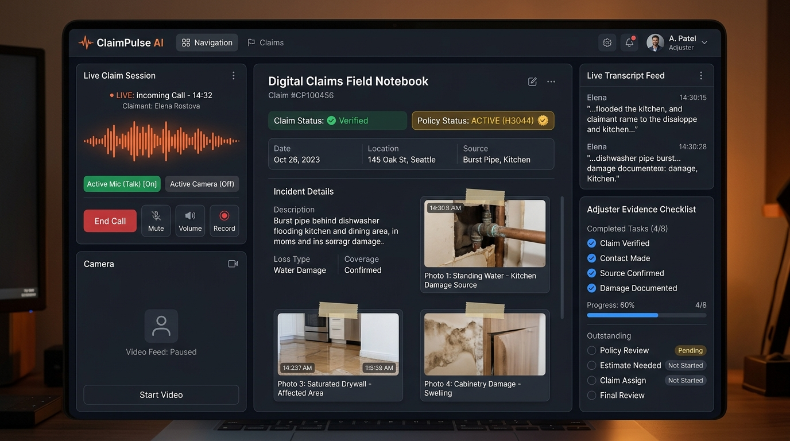
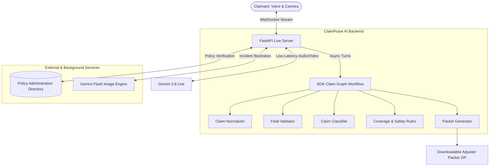

# ClaimPulse AI

[](https://www.python.org/)
[](https://fastapi.tiangolo.com/)
[](https://ai.google.dev/)
[](LICENSE)
[]()

> **Real-Time Multimodal Insurance Claim Intelligence & Automated FNOL Triage Agent**

**ClaimPulse AI** is an intelligent, voice-first insurance intake assistant designed to streamline First Notice of Loss (FNOL). It conducts live natural conversations, inspects property and vehicular damage through real-time camera streams, verifies loss facts against mock policy records, generates incident diagrams on the fly, and compiles a comprehensive adjuster claim packet ready for human review.

---



---

## 🌟 Key Capabilities

- **🎙️ Low-Latency Live Conversation:** Bidirectional voice interactions with live streaming transcripts powered by Gemini 3.8 Live.
- **📷 Real-Time Vision & Evidence Pinning:** Claimants share live damage feeds through their camera. The agent identifies key damage points, captions observations, and verifies evidence frames in real time.
- **🎨 Dynamic Incident Sketching:** Generates spatial accident diagrams and flood/structural loss illustrations based on claimant accounts and live conversational corrections.
- **📋 Live Claims Field Notebook:** Displays extracted facts, policy verification badges, missing checklist items, and automated fraud/safety gating rules.
- **📦 Instant Adjuster Packet Generation:** Packages Markdown claim notes, evidence manifests, high-res captured frames, and incident diagrams into a downloadable ZIP packet.
- **👤 Optional Synchronized Avatar:** Supports interactive AI video avatars with synchronized voice and lip movements.

---

## 🏗️ System Architecture



---

## 🚀 Quick Start

### 1. Prerequisites
- **Python 3.12** or higher
- **Node.js 20+** (for UI client regression tests)
- **Google Gemini API Key** with access to Gemini Live models

### 2. Clone & Setup

```bash
# Clone the repository
git clone https://github.com/prakashkudale/claimpulse-ai.git
cd claimpulse-ai

# Create and activate virtual environment
python -m venv .venv

# On Linux/macOS:
source .venv/bin/activate
# On Windows:
.venv\Scripts\activate

# Install required dependencies
pip install -r requirements.txt
```

### 3. Configure Environment

Copy the example environment file and configure your credentials:

```bash
cp .env.example .env
```

Open `.env` and set:

```dotenv
GOOGLE_GENAI_USE_VERTEXAI=False
GOOGLE_API_KEY=your-gemini-api-key
```

### 4. Run the Application

Start the FastAPI application with Uvicorn:

```bash
python -m uvicorn live_demo.server:app --reload --host 127.0.0.1 --port 4177
```

Navigate to **[http://127.0.0.1:4177](http://127.0.0.1:4177)** in your browser.

- **Talk:** Begin interactive voice intake.
- **Show Camera:** Point camera at damaged property, car collision points, or receipts.
- **Adjuster Packet:** Preview live status and download the full intake dossier.
- **New Intake:** Reset the workspace for a new claimant session.

---

## ⚙️ Configuration Reference

| Environment Variable | Default | Description |
| :--- | :--- | :--- |
| `GOOGLE_API_KEY` | *(Required)* | Google Gemini API key |
| `GOOGLE_GENAI_USE_VERTEXAI` | `False` | Set `True` if utilizing Google Cloud Vertex AI |
| `FNOL_GEMINI_LIVE_MODEL` | `gemini-3.8-live` | Model powering live voice conversation |
| `FNOL_SKETCH_MODEL` | `gemini-3.1-flash-image` | Model powering incident illustration sketches |
| `FNOL_VOICE` | `Kore` | Audio voice synthesis profile |
| `FNOL_TRANSCRIPTION_VOCABULARY` | `""` | Comma-separated domain vocabulary hints |
| `FNOL_AVATAR_NAME` | `""` | Prebuilt avatar persona name (leave blank for voice-only) |
| `FNOL_AVATAR_PROJECT` | `""` | Google Cloud project ID for avatar streaming |
| `FNOL_AVATAR_LOCATION` | `us-central1` | Regional endpoint for avatar services |

---

## 📂 Project Structure

```
claimpulse-ai/
├── agent.py               # ADK hybrid graph: normalization, classification & rules
├── policies.py            # Deterministic coverage, evidence rules & packet compiler
├── policy_directory.py    # Policy administration records and lookup engine
├── schemas.py             # Pydantic data models and validation contracts
├── examples.py            # Sample incident scenarios for evaluation
├── requirements.txt       # Core Python dependencies
├── pyproject.toml         # Project metadata and package definition
├── LICENSE                # MIT License
├── live_demo/             # Real-time web application
│   ├── server.py          # FastAPI server, WebSocket handlers & packet compiler
│   ├── live_tools.py      # Background tool contracts and agent system instructions
│   ├── app.js             # Client-side audio/video streaming & notebook rendering
│   ├── avatar.js          # Synchronized avatar playback and interruption engine
│   ├── index.html         # Responsive three-column claims workspace
│   └── styles.css         # Modern desk & digital notebook UI styles
├── tests/                 # Comprehensive test suite
│   ├── test_regressions.py       # Deterministic policy & evidence test cases
│   ├── test_live_turns.py        # WebSocket event ordering & conversation tests
│   ├── test_avatar.py            # Avatar config & media streaming tests
│   ├── client-regressions.cjs    # Browser-side regression tests
│   └── avatar-player.cjs         # Media Source Extensions player tests
└── assets/                # Visual assets and architecture diagrams
```

---

## 🧪 Testing Suite

ClaimPulse AI includes a test suite covering deterministic policies, live session state management, interruption handling, and client-side playback.

```bash
# Run all Python unit & regression tests
python -m unittest discover -s tests -p 'test_*.py'

# Run client-side regressions (Node.js required)
node tests/client-regressions.cjs

# Run avatar playback regressions
node tests/avatar-player.cjs
```

---

## 📄 License

This project is licensed under the MIT License - see the [LICENSE](LICENSE) file for details.
